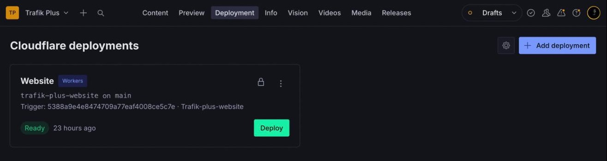
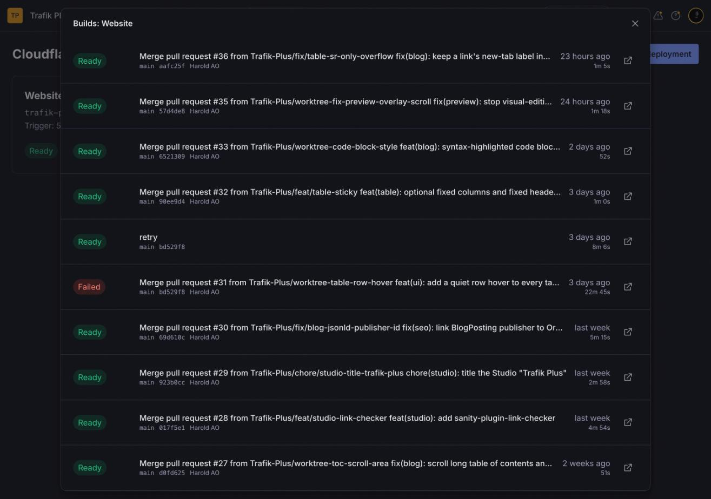
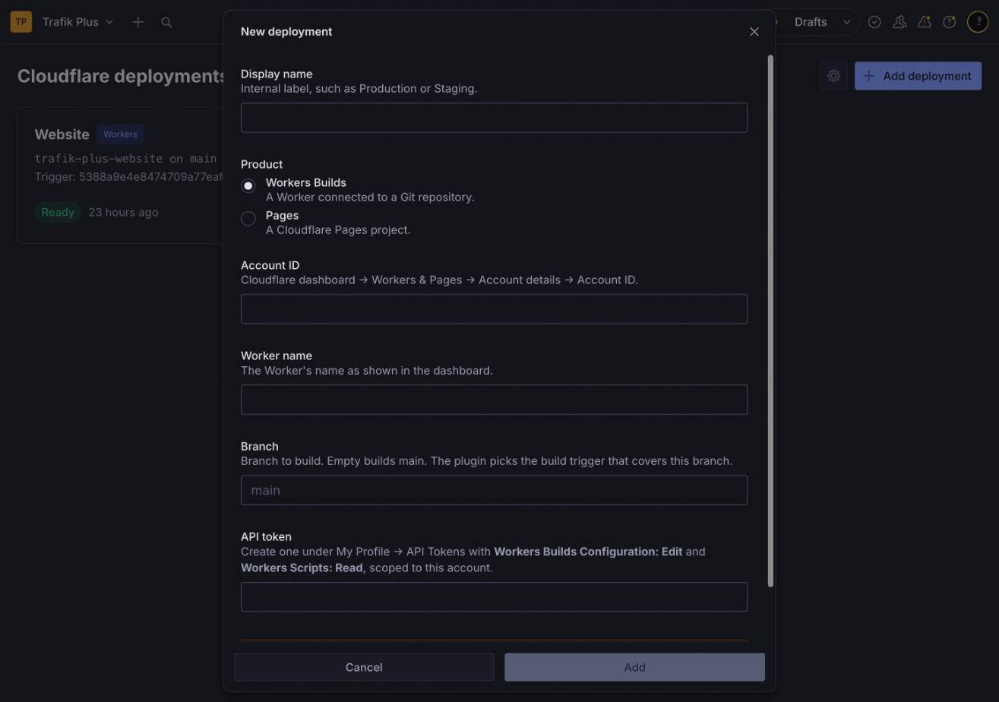

# @trafik-plus/sanity-plugin-cloudflare-deploy

Trigger and watch Cloudflare deploys from Sanity Studio. Supports **Workers Builds** (a Worker connected to Git) and **Cloudflare Pages**, and as many deployments as you like — production, staging, a docs site — each with its own account, project, branch and token.

- Deploy button per deployment, with live status (queued, building, ready, failed, canceled) polled while a build runs
- Build history with commit message, branch, hash, author, duration and a link to the Cloudflare dashboard
- Cancel a running Workers build
- Add, edit and delete deployments from the Studio, or define them in the Studio config (shown locked)
- Works with Sanity Studio v4, v5 and v6 (`@sanity/ui` v4)







Inspired by [sanity-plugin-vercel-deploy](https://github.com/ndimatteo/sanity-plugin-vercel-deploy) and [sanity-plugin-cloudflare-pages-deploy](https://github.com/estallio/sanity-plugin-cloudflare-pages-deploy).

## Install

```sh
npm install @trafik-plus/sanity-plugin-cloudflare-deploy
```

Not to be confused with the unscoped `sanity-plugin-cloudflare-deploy` on npm, a different, Pages-only plugin.

## Configure

### 1. Add the tool

```ts
// sanity.config.ts
import {defineConfig} from 'sanity'
import {cloudflareDeployTool} from '@trafik-plus/sanity-plugin-cloudflare-deploy'

export default defineConfig({
  // …
  plugins: [
    cloudflareDeployTool(),
  ],
})
```

Options (all optional):

| Option | Default | |
| --- | --- | --- |
| `name` | `cloudflare-deploy` | Tool route |
| `title` | `Deploy` | Navbar label |
| `icon` | `RocketIcon` | Navbar icon |
| `apiBaseUrl` | `/cloudflare-api/client/v4` | Where API calls go (see the proxy below) |
| `deployments` | `[]` | Deployments defined in code |

Deployments defined in code are locked in the UI (no edit or delete) and use one shared API token, which an editor enters once from the cog button:

```ts
cloudflareDeployTool({
  deployments: [
    {
      name: 'Website',
      kind: 'workers',
      accountId: '<account id>',
      workerName: 'my-site',
      branch: 'main',
    },
    {
      name: 'Docs',
      kind: 'pages',
      accountId: '<account id>',
      pagesProject: 'my-docs',
    },
  ],
})
```

### 2. Add the API proxy

The Cloudflare API sends no CORS headers, so the Studio cannot call `api.cloudflare.com` from the browser. The plugin calls a same-origin path instead, and you forward it. The proxy stores no credentials — the token travels with each request — and it forwards only the seven endpoints the plugin uses.

**`sanity dev`** — add the Vite proxy in `sanity.cli.ts`:

```ts
import {defineCliConfig} from 'sanity/cli'
import {cloudflareApiViteProxy} from '@trafik-plus/sanity-plugin-cloudflare-deploy/proxy'

export default defineCliConfig({
  // …
  vite: (config) => ({
    ...config,
    server: {
      ...config.server,
      proxy: {...config.server?.proxy, ...cloudflareApiViteProxy()},
    },
  }),
})
```

**Studio hosted on a Cloudflare Worker** — handle the path before serving assets:

```ts
// worker.ts
import {handleCloudflareApiProxy} from '@trafik-plus/sanity-plugin-cloudflare-deploy/proxy'

export default {
  async fetch(request, env) {
    return (await handleCloudflareApiProxy(request)) ?? env.ASSETS.fetch(request)
  },
} satisfies ExportedHandler<{ASSETS: Fetcher}>
```

With static assets, route the prefix to the Worker first (`wrangler.jsonc`):

```jsonc
"assets": {"directory": "./dist", "binding": "ASSETS", "run_worker_first": ["/cloudflare-api/*"]}
```

**Studio hosted elsewhere** (sanity.studio, Vercel, Netlify…) — run the same handler on any Worker and point `apiBaseUrl` at it, adding the CORS headers your Studio origin needs, or use your host's rewrite rules to forward `/cloudflare-api/*` to `https://api.cloudflare.com/*`.

## API tokens

Create a token under **My Profile → API Tokens → Create Custom Token**, scoped to the account:

| Product | Permissions |
| --- | --- |
| Workers Builds | Account · **Workers Builds Configuration: Edit**, Account · **Workers Scripts: Read** |
| Pages | Account · **Cloudflare Pages: Edit** |

For Workers, the Worker must be connected to a Git repository (Settings → Builds). The plugin picks the build trigger whose branch filters cover the deployment's branch: an exact include beats a wildcard, and excludes are honoured.

## Security

Deployments added in the Studio, with their tokens, are stored as documents with dotted ids (`cloudflare-deploy.<uuid>`, and `secrets.cloudflareDeploy` for the shared token). Dotted ids are private: they never appear in unauthenticated or token-less public queries. They are readable by **every member of the Sanity project** with read access to the dataset, so give each token the minimum permissions above and only to accounts whose Studio members may deploy.

"Prevent deletion in production" hides Delete in production builds of the Studio; it is a guard against slips, not access control.

## Develop

```sh
npm install
npm test          # node:test, trigger matching and proxy allowlist
npm run typecheck
npm run build
```

Test in a Studio with `npm install ../sanity-plugin-cloudflare-deploy`.

### Release

Every push to `main` runs the tests, typecheck and build. When the `version` in `package.json` is not on npm yet, the workflow publishes it, through npm trusted publishing (no token stored in the repo). To release, bump the version and push:

```sh
npm version patch   # or minor / major
git push --follow-tags
```

## License

MIT
